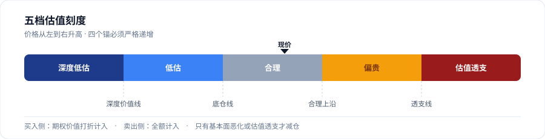
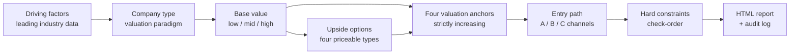

<div align="center">

# Value Investing Analysis

**First ask which data actually drives the stock price. Then ask what the business is worth. Only then ask whether — and when — to act.**

A cross-platform, stateless, auditable Agent Skill that turns single-stock fundamentals, two-sided valuation, position-building paths, and daily executable decisions into one consistent rule set.

[](https://agentskills.io/specification)
[](https://www.python.org/)
[](#faq)
[](SKILL.md)
[](LICENSE)

[中文](README.md) · [Quick Start](#quick-start) · [Platform Adapters](references/platform-adapters.md) · [Full Spec](SKILL.md)

</div>

---

> **This is not a stock screener and not a price predictor.** It is a discipline encoded in `SKILL.md`: every amount, share count, and entry price must come from the script; no valuation anchors means no buy recommendation; a falling price is never, by itself, a reason to sell.

> The skill body and reference documents are written in Chinese. They are the authoritative source; this README is a human-facing guide.

## Why it exists

Most "AI stock analysis" gets the **order** wrong: it reads the chart, then reverse-engineers a fundamental story. Or it computes a single deep-discount entry price that never prints, leaving the account in cash indefinitely.

| Typical approach | This skill |
|---|---|
| Target price first, justification later | Register **driving factors** first (sow herd, wholesale price, freight rate, US 10Y yield…), then derive valuation |
| Downside-only "cheap price" | **Two-sided valuation**: deep value line + priced upside options (asset injection, second curve, share gains, policy improvement) |
| Trim because it dropped or is underwater | Trim only on **fundamental deterioration** or **valuation exhaustion** |
| Wait for one price that never comes | **Three entry channels (A / B / C)** plus time-for-price tranches |
| Recall P/E, price, or earnings from memory | Every number comes from a real tool response with timestamp and reporting period; unavailable means "not retrieved" |
| Conclusions scattered across chat | Three fixed HTML slots + `analysis_log.jsonl` for audit |



## Key features

| | Feature | What it means |
|---|---|---|
| **01** | Factors first | "If this number changes, would I change next year's earnings forecast?" If yes, it is a driver. Price, candles, and analyst targets are not |
| **02** | Two-sided valuation | Three base-value tiers + a priced option list; options discounted on the buy side, full on the sell side |
| **03** | Rate denominator | The 10Y US Treasury yield is the only channel allowed to change multiples without changing earnings — it never touches EPS |
| **04** | Stateless | Each run depends only on current holdings and current price; a fresh session cannot inherit yesterday's bias |
| **05** | Script adjudicates | `portfolio.py` owns every amount, share count, channel, and hard constraint — no mental math, no ad-hoc prices |
| **06** | Delivery gates | `lint-report` (silent CSS failure), `selfcheck` (docs vs code drift), `check-order` (per-order constraints) |
| **07** | Data isolation | Holdings live in `~/.value-investing/`, separate from the skill folder; upgrades never delete data |
| **08** | Platform neutral | Follows the open Agent Skills spec; all tool names are capability placeholders |

## Analysis chain



Four scenarios share the same standard; only timing and delivery differ:

| Scenario | When | Output |
|---|---|---|
| **A Onboarding / deep dive** | On demand | Full fundamental report, written to the portfolio file |
| **B Morning plan** | Weekdays 09:30 | "Condition → action" plan, no fixed fill price |
| **C Close decision** | 14:30 (A-shares) / 15:30 (HK) | Buy / sell / hold + shares + limit price + constraint checklist |
| **D Ad-hoc analysis** | On demand | One standalone report; no portfolio write, no scheduled task, no history |

## Quick Start

### 1. Install

The **repository root is the skill folder**. The destination folder must be named `value-investing-analysis` to match `SKILL.md`'s `name`.

macOS / Linux (Claude Code example):

```bash
git clone https://github.com/Leager-zju/ValueInvestingAnalysis.git \
  ~/.claude/skills/value-investing-analysis
```

Windows PowerShell:

```powershell
git clone https://github.com/Leager-zju/ValueInvestingAnalysis.git `
  "$HOME\.claude\skills\value-investing-analysis"
```

Paths for Codex, Cursor, Copilot, Gemini CLI, and the shared `.agents/skills/` convention are in the **[Platform Adapter Guide](references/platform-adapters.md)**.

### 2. Verify

```bash
python --version                                  # 3.9+, standard library only
python ~/.claude/skills/value-investing-analysis/scripts/portfolio.py path
```

The second command prints the real data directory — **run it before assuming any path**. Data defaults to `~/.value-investing/`; override with `VI_DATA_DIR`.

### 3. Just ask

The examples below use `000000` as a neutral placeholder ticker; replace it with a real stock code.

```
Analyze 000000 for me; I want to track it long term
```

The skill runs an environment check, verifies the data source, asks four investor-profile questions, and then asks whether you want daily tracking — **it never defaults this for you**. Choose one-off analysis to get a complete report in `_adhoc/` with zero writes to the portfolio file.

### 4. Optional: scheduled tasks

Create three weekday automations — 09:30 morning plan, 14:30 A-share close, 15:30 HK close. The skill ships no automation config; only the trigger changes, the rules do not.

## Common commands

`<skill>` is the skill folder. Full command list: [`SKILL.md`](SKILL.md).

| Command | Purpose |
|---|---|
| `python <skill>/scripts/portfolio.py path` | Print the real data path (always run first) |
| `... show --code 000000` | Show holdings and profile |
| `... upsert --code 000000 --shares 1000 --cost 100 --budget 100000` | Create / update a position (copy broker values) |
| `... set-prefs --regret-aversion high --drawdown-tolerance mid` | Global profile: regret aversion / drawdown tolerance |
| `... set-drivers --code 000000 --file drivers.json` | Register key driving factors |
| `... option --code 000000 --file options.json` | Register upside options and compute per-share value |
| `... calc --code 000000 --price 100` | Five valuation bands, entry ladder, room, re-anchor status |
| `... check-order --code 000000 --side buy ...` | Validate a proposed order against hard constraints |
| `... new-report --code 000000 --session close` | Get the fixed report slot path (overwrites) |
| `... lint-report --code 000000 --session close` | Pre-delivery structural/style check |
| `... selfcheck` | Assert docs and code agree — run before every delivery |
| `... index` | Generate the persistent `reports/index.html` |

## Report output

Reports are **self-contained single-file HTML** — no CDN, no build step, open directly in a browser:

- Dark header, verdict bar, four metric tiles, conclusion first
- Driving-factor block before company type, with readings, dates, and transmission chain
- Five-band valuation scale with a live price cursor, option cards, constraint table, position buckets
- Red for up / green for down (A-share convention), tabular numerals
- Sticky navigation linking the three slots back to the report index
- Three fixed slots per ticker, overwritten in place; history lives in `analysis_log.jsonl`

Layout source: [`assets/report-template.html`](assets/report-template.html). Every number, date, and issuer clue in the template is a `__XXX__` placeholder — **it is not real holdings data** and must be replaced with script-computed values when generating a report.

## Repository layout

```
value-investing-analysis/
├── SKILL.md                         Entry point (frontmatter + full rules)
├── README.md / README.en.md / LICENSE
├── docs/valuation-ladder.svg        Diagram used in the READMEs
├── scripts/
│   └── portfolio.py                 Holdings, valuation, checks, report generation
├── references/                      Loaded on demand
│   ├── cheatsheet.md                One-page quick reference (start here)
│   ├── platform-adapters.md         Capability mapping and install paths
│   ├── onboarding.md                Environment check and investor profiling
│   ├── company-type.md              Six company archetypes
│   ├── drivers.md                   Factor library, rate factor, factor chains
│   ├── data-sources.md              Fields, freshness checks, fallback chain
│   ├── fundamental-standard.md      Two-sided valuation, quality score, anchors
│   ├── decision-rules.md            Core / swing strategies and hard constraints
│   └── report-templates.md          Content skeletons for the three outputs
└── assets/
    └── report-template.html         Report layout
```

## Platform neutrality

`AskUserQuestion`, `present_files`, `data_*`, `domain_search`, and `WebSearch` in `SKILL.md` and `references/` are **capability placeholders**, not proprietary APIs. If your client has no tool with that name, substitute its equivalent or follow the documented fallback chain — **never skip the step or invent data**.

The only hard dependency is Python 3.9+. Market data can fall back; Python cannot be worked around. See **[`references/platform-adapters.md`](references/platform-adapters.md)** for the full mapping, per-client install paths, `VI_DATA_DIR`, and scheduled-task differences.

## FAQ

<details>
<summary>Can I use it without a market-data connector?</summary>

Yes, with lower conclusion quality. Follow the fallback chain in `references/data-sources.md`, cite sources and dates, and write "not retrieved" plus the impact on the conclusion whenever data is missing. **Never substitute remembered or estimated values for measured ones.**
</details>

<details>
<summary>Are my holdings uploaded anywhere?</summary>

No. `portfolio.json`, `analysis_log.jsonl`, and reports stay on your machine under `~/.value-investing/` (or `VI_DATA_DIR`), separate from the skill folder. `.gitignore` excludes them. Use a distinct `VI_DATA_DIR` per account for isolation.
</details>

<details>
<summary>Why can't I click report links in chat?</summary>

`file://` links are blocked by most clients' security policy and render as raw text. Clients with a file-preview capability push a card; otherwise an absolute path is returned and the report opens in a browser, with slot navigation and an index link still built in.
</details>

<details>
<summary>Does it do portfolio-level risk management?</summary>

No. It covers a **single ticker**: fundamentals, valuation, and entry path. No cross-asset correlation, no sector diversification, no total-asset cap, no total-asset tracking. `budget` is simply "how much this money can buy"; `invested_ratio_pct` measures budget consumption, not risk.
</details>

<details>
<summary>How do I validate spec compliance?</summary>

`SKILL.md` has required `name` / `description`, the folder name matches `name`, and the layout follows the recommended `scripts/ references/ assets/` split. Validate with `skills-ref validate ./value-investing-analysis`.
</details>

## Disclaimer

**For personal research and decision-support only. This is not investment advice, an offer, or any promise of returns.** Investing involves risk; historical data and valuation models cannot predict future prices. Verify every output independently and accept full responsibility for your decisions. The author is not liable for any loss arising from use of this skill.

The framework assumes a **holding period of 3+ years**. If the capital may be needed within a year, the onboarding profile stops the workflow.

## License

[MIT](LICENSE) © 2026 Leager-zju — use, modify, and commercialize freely with attribution.

<div align="center">

[中文](README.md) · [Full Spec](SKILL.md) · [Platform Adapters](references/platform-adapters.md) · [Report Template](assets/report-template.html)

</div>
