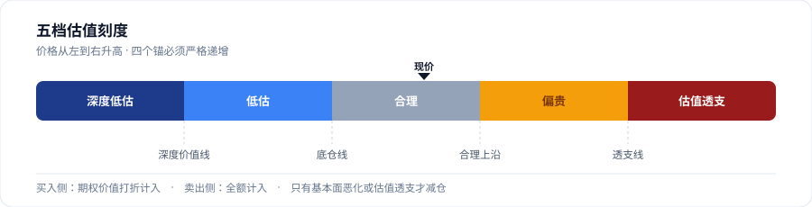
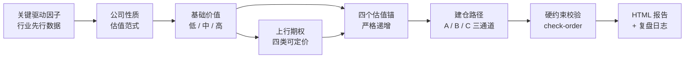

<div align="center">

# Value Investing Analysis

**先搞懂「它的股价由哪几个数据驱动」，再谈「这家公司值多少钱」，最后才谈「要不要动手、什么时候动手」。**

一个跨平台、无状态、可复核的 Agent Skill，把单只股票的基本面、双层估值、建仓路径与每日可执行决策串成同一套规则。

[](https://agentskills.io/specification)
[](https://www.python.org/)
[](#常见问题)
[](SKILL.md)
[](LICENSE)

[English](README.en.md) · [快速开始](#快速开始) · [平台适配](references/platform-adapters.md) · [规范文档](SKILL.md)

</div>

---

> **它不是选股器，也不是行情预测器。** 它是一套写在 `SKILL.md` 里的纪律：所有金额、股数、买点必须由脚本算出来；没有估值锚不许给买入建议；价格下跌本身永远不是卖出理由。

## 它解决什么问题

多数「AI 炒股」输出的问题不是算错，而是**顺序错了**：先看 K 线和当日涨跌，再倒推基本面结论；或者只算一个深度折价买点，价格永远不到，于是长期空仓。

| 常见做法 | 本技能的做法 |
|---|---|
| 先给目标价，再找理由 | 先登记**驱动因子**（能繁存栏、批价、运价、10Y 美债…），再推导估值 |
| 只算下行「便宜价」 | **双向估值**：深度价值线 + 上行期权（资产注入 / 第二曲线 / 份额跃升 / 政策改善） |
| 因为跌了、浮亏了就减仓 | 只在**基本面恶化**或**估值透支**两种情况下减仓 |
| 等一个永远不到的价位 | **A / B / C 三档建仓通道** + 时间换价格，避免单点挂价 |
| 用记忆里的 PE、股价、财报 | 所有数字来自工具真实返回，附时点与报告期；取不到就写「未取到」 |
| 结论散落在聊天里 | 固定三个 HTML 槽位 + `analysis_log.jsonl`，随时可回看、可复核 |



## 核心特性

| | 特性 | 说明 |
|---|---|---|
| **01** | 因子优先 | 先回答「这个数据变了，我会改明年盈利预测吗」，会就是驱动因子；股价、K 线、目标价都不是 |
| **02** | 双层估值 | 基础价值三档 + 可定价期权清单，买入侧打折、卖出侧全额；期权占比越界自动拦截 |
| **03** | 利率分母 | 唯一允许「不改盈利也改估值」的通道：10 年期美债收益率只走倍数修正，绝不拿它改 EPS |
| **04** | 无状态 | 每次只基于当前持仓与当前价格，不依赖前几天做过什么，新会话不会记错 |
| **05** | 脚本裁决 | 金额、股数、通道、硬约束全部由 `portfolio.py` 计算，禁止心算与即兴报价 |
| **06** | 交付闸门 | `lint-report` 查样式静默失效、`selfcheck` 查文档与代码脱节、`check-order` 逐条核对下单 |
| **07** | 数据隔离 | 持仓存 `~/.value-investing/`，与技能目录分离；升级或重装技能不丢数据 |
| **08** | 跨平台 | 遵循 Agent Skills 开放规范，不绑定任何客户端；工具名均为能力占位符 |

## 分析链路



四类场景共用同一套标准，区别只在时点与交付形式：

| 场景 | 时点 | 输出 |
|---|---|---|
| **A 建档与深度分析** | 随时 | 完整基本面报表，写入持仓档案 |
| **B 早盘预案** | 工作日 09:30 | 「条件 → 动作」预案，不写死成交价 |
| **C 尾盘决策** | 14:30（A 股）/ 15:30（港股） | 买 / 卖 / 不动 + 股数 + 限价 + 硬约束核对表 |
| **D 临时分析** | 随时 | 一份独立报告，不建档、不进定时任务、不累积历史 |

## 快速开始

### 1. 安装

仓库根目录**就是技能目录**，克隆时的目标文件夹必须叫 `value-investing-analysis`（与 `SKILL.md` 的 `name` 一致）。

macOS / Linux（以 Claude Code 为例）：

```bash
git clone https://github.com/Leager-zju/ValueInvestingAnalysis.git \
  ~/.claude/skills/value-investing-analysis
```

Windows PowerShell：

```powershell
git clone https://github.com/Leager-zju/ValueInvestingAnalysis.git `
  "$HOME\.claude\skills\value-investing-analysis"
```

其他客户端的目录（Codex / Cursor / Copilot / Gemini CLI / `.agents/skills/` 通用约定）见 **[平台适配指南](references/platform-adapters.md)**。

### 2. 确认环境

```bash
python --version                                  # 需要 3.9+，仅标准库
python ~/.claude/skills/value-investing-analysis/scripts/portfolio.py path
```

第二条会打印真实的数据目录，**先跑它，不要猜路径**。数据默认落在 `~/.value-investing/`，可用 `VI_DATA_DIR` 改到别处。

### 3. 直接说话

下文统一用 `000000` 作为中性占位代码，实际使用时请替换成真实股票代码。

```
帮我分析一下 000000，我要长期跟踪
```

技能会先做环境自检、确认数据源、问 4 道投资者画像题，然后问你「要不要加入每日任务分析」——**这一步不会替你默认**。只想看一次结论就选「只做一次性分析」，报告落到 `_adhoc/`，持仓档案零写入。

### 4. 想每天自动跑（可选）

按平台建三个工作日任务：09:30 早盘预案、14:30 A 股尾盘、15:30 港股尾盘。技能不自带自动化配置，规则不变，只是触发方式不同。

## 常用命令

`<skill>` 代指技能目录。完整子命令与参数见 [`SKILL.md`](SKILL.md)。

| 命令 | 用途 |
|---|---|
| `python <skill>/scripts/portfolio.py path` | 打印真实数据路径（第一条永远先跑这个） |
| `... show --code 000000` | 查看持仓与画像 |
| `... upsert --code 000000 --shares 1000 --cost 100 --budget 100000` | 建档 / 更新持仓（照抄券商显示值） |
| `... set-prefs --regret-aversion high --drawdown-tolerance mid` | 全局画像：踏空厌恶 / 浮亏容忍 |
| `... set-type --code 000000 --primary ...` | 确认公司性质与估值范式 |
| `... set-drivers --code 000000 --file drivers.json` | 登记关键驱动因子 |
| `... option --code 000000 --file options.json` | 登记上行期权并算每股价值 |
| `... set-thesis --code 000000 --file thesis.json` | 写入质地分、基础价值、四个锚 |
| `... calc --code 000000 --price 100` | 五档估值区、建仓阶梯、额度、锚复评状态 |
| `... check-order --code 000000 --side buy ...` | 逐条校验一笔拟下单 |
| `... new-report --code 000000 --session close` | 取报告落盘路径（固定槽位，同名覆盖） |
| `... lint-report --code 000000 --session close` | 交付前样式结构自检 |
| `... selfcheck` | 规则与代码一致性断言，每次交付必跑 |
| `... index` | 生成 `reports/index.html` 常驻索引 |

## 输出长什么样

报告是**单文件自包含 HTML**，无 CDN、无构建步骤，双击即开：

- 深色页头 + 结论条 + 四格指标，**中文结论先行**
- 驱动因子区块排在公司性质之前，附最新读数、日期与传导链
- 五档估值刻度条 + 现价游标、上行期权卡、约束核对表、仓位分桶
- 涨红 `#d92020` / 跌绿 `#0f8a5f`（A 股习惯），数字统一等宽
- 页头自带 sticky 导航，早盘 / 尾盘 / 深度三槽位互跳，并可返回报告索引
- 每个标的固定三个槽位，同名覆盖；历史结论由 `analysis_log.jsonl` 承担，不堆文件

版式源文件：[`assets/report-template.html`](assets/report-template.html)，内容骨架见 [`references/report-templates.md`](references/report-templates.md)。模板内所有数值、日期与标的线索均为 `__XXX__` 占位示例，**与任何真实持仓无关**；生成报告时必须用脚本计算值替换。

## 目录结构

```
value-investing-analysis/
├── SKILL.md                         技能入口（frontmatter + 完整规则）
├── README.md / README.en.md / LICENSE
├── docs/valuation-ladder.svg        README 用示意图
├── scripts/
│   └── portfolio.py                持仓、估值、校验、报告生成（纯标准库）
├── references/                     按需加载的细节文档
│   ├── cheatsheet.md               一页速查（第一次用先看这个）
│   ├── platform-adapters.md        跨平台能力映射与安装路径
│   ├── onboarding.md               环境自检、投资者画像问卷
│   ├── company-type.md             六类公司性质判定
│   ├── drivers.md                  驱动因子库、利率因子、因子链
│   ├── data-sources.md             取数字段、时效校验、降级链
│   ├── fundamental-standard.md     双层估值、质地评分、四锚推导
│   ├── decision-rules.md           底仓 / 波段两套策略与硬约束
│   └── report-templates.md         三种输出的内容骨架
└── assets/
    └── report-template.html        报表视觉版式
```

## 跨平台说明

`SKILL.md` 与 `references/` 里出现的 `AskUserQuestion`、`present_files`、`data_*`、`domain_search`、`WebSearch` 都是**能力占位符**，不是某个产品的私有 API。你的客户端没有同名工具时，用等价能力替换，或按文内降级链处理——**不能因此跳过步骤或编造数据**。

唯一硬依赖是 Python 3.9+。行情数据源可降级，Python 不能绕过。完整映射表、各客户端安装路径、`VI_DATA_DIR` 配置与定时任务差异见 **[`references/platform-adapters.md`](references/platform-adapters.md)**。

## 常见问题

<details>
<summary>没有接行情数据源，还能用吗？</summary>

可以，但结论质量会下降。按 `references/data-sources.md` 的降级链改用检索能力，并在报告里标注来源与日期；拿不到的数据必须写「未取到」及其对结论的影响。**禁止用记忆值、估算值冒充实测值。**
</details>

<details>
<summary>会记录我的持仓吗？数据传到哪里？</summary>

不会上传任何数据。`portfolio.json`、`analysis_log.jsonl` 和报告全部存在本机 `~/.value-investing/`（或 `VI_DATA_DIR` 指定处），与技能目录分离。仓库里的 `.gitignore` 已排除这些文件。想一人多账户隔离，给每个账户设不同的 `VI_DATA_DIR`。
</details>

<details>
<summary>为什么我不能在聊天里直接点报告链接？</summary>

`file://` 链接在多数客户端被安全策略拦截，只会显示成原始文本。有文件预览能力的客户端会推卡片；没有的话直接给绝对路径，用浏览器打开即可，报告页顶部仍有三槽位互跳和索引入口。
</details>

<details>
<summary>它做组合风险管理吗？</summary>

不做。只做**单标的**的基本面、估值与建仓路径，不评估标的间相关性、不做行业分散、不设占总资产上限、不跟踪总资产。`budget` 只是「这笔钱能投多少」，`invested_ratio_pct` 是预算消耗度，不是风险指标。
</details>

<details>
<summary>怎么确认技能符合 Agent Skills 规范？</summary>

`SKILL.md` 含必填的 `name` / `description`，目录名与 `name` 一致，并采用规范推荐的 `scripts/ references/ assets/` 三段式。可用 `skills-ref validate ./value-investing-analysis` 校验。
</details>

## 免责声明

**本项目仅用于个人研究与投资决策辅助记录，不构成任何投资建议、要约或收益承诺。** 证券投资有风险，历史数据与估值模型不能预测未来价格。所有输出应由使用者自行核实并独立承担决策后果；作者不对依据本技能产生的任何直接或间接损失负责。

技能默认假设 **3 年以上持有期**。若资金 1 年内可能要用，首次画像会直接劝退，不应继续建档。

## 许可证

[MIT](LICENSE) © 2026 Leager-zju — 可自由使用、修改、商用，保留署名即可。

<div align="center">

[English](README.en.md) · [规范文档](SKILL.md) · [平台适配](references/platform-adapters.md) · [报告模板](assets/report-template.html)

</div>
